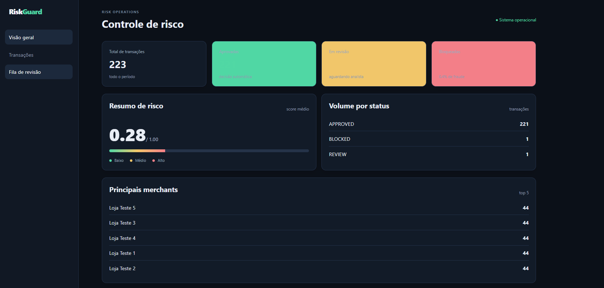
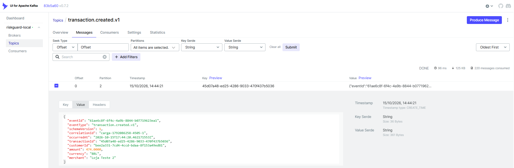
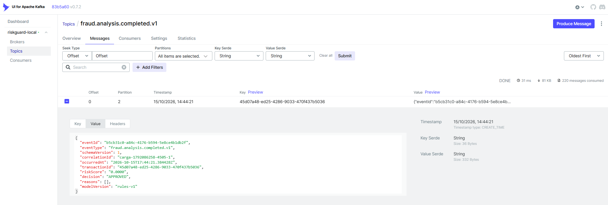
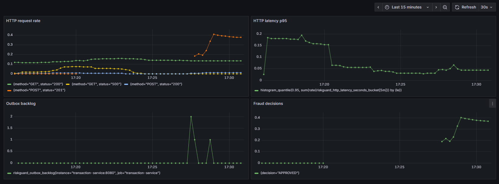
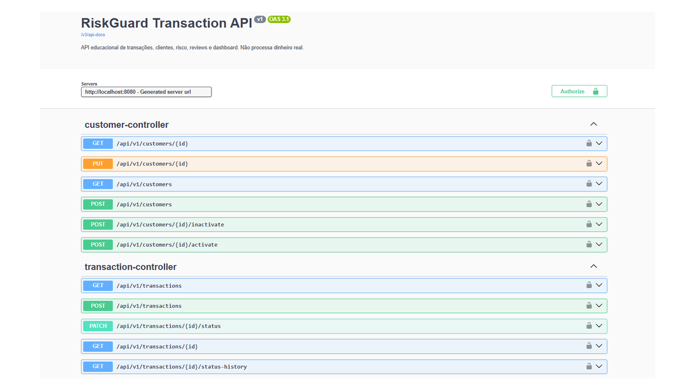
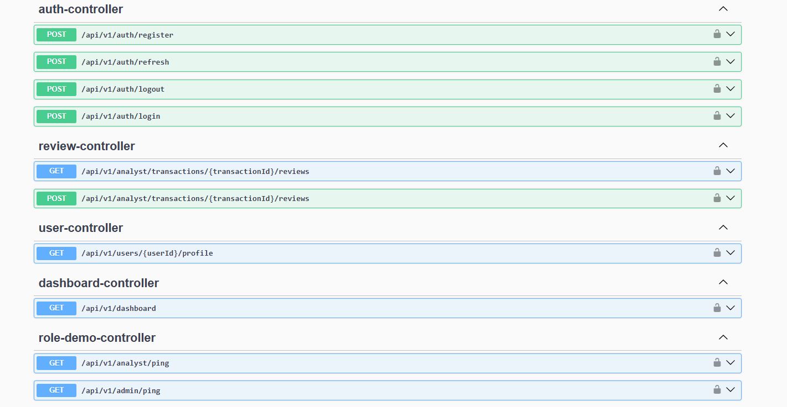
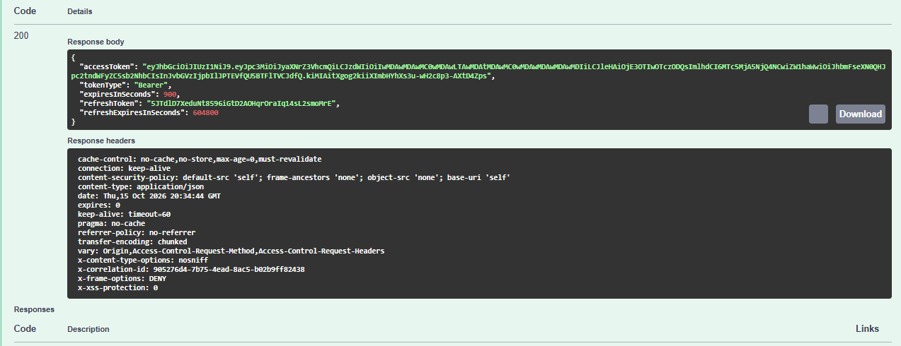
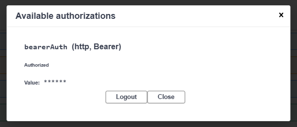
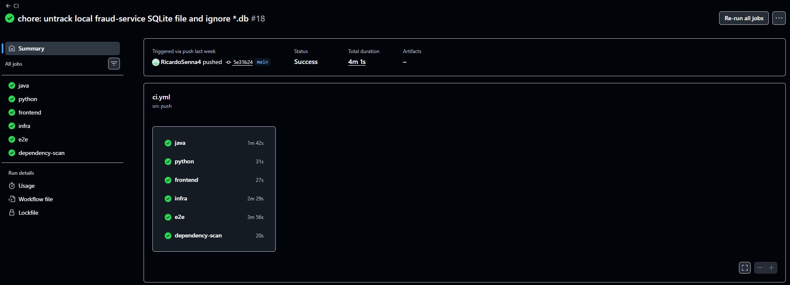

# RiskGuard

[](https://github.com/RicardoSenna4/riskguard/actions/workflows/ci.yml)
[](https://github.com/RicardoSenna4/riskguard/actions/workflows/codeql.yml)

Plataforma educacional de análise de risco para transações, desenvolvida para demonstrar integração entre uma API transacional, um serviço antifraude assíncrono e uma camada de observabilidade.

O projeto cobre o ciclo completo de uma transação: autenticação, cadastro de clientes, criação, análise de risco, decisão automática, revisão manual e acompanhamento operacional. **Não processa pagamentos nem movimenta dinheiro real.**

## Visão geral



O dashboard apresenta volume de transações, status, score médio, fila de revisão e distribuição por merchant.

### Funcionalidades principais

- Autenticação com JWT, refresh token, BCrypt e controle de acesso por perfil.
- Gestão de clientes com validação, ownership, ativação/inativação e paginação.
- Gestão de transações com filtros, idempotência HTTP e optimistic locking.
- Análise antifraude com decisão `APPROVED`, `REVIEW` ou `BLOCKED`.
- Revisão humana com justificativa, histórico e auditoria.
- Transactional Outbox, retries, deduplicação e Dead Letter Queue.
- Métricas operacionais, healthchecks, logs com correlation ID e dashboards Grafana.

## Arquitetura

O frontend React é servido pelo Nginx e consome o Transaction Service, implementado em Java com Spring Boot. O serviço transacional persiste dados no PostgreSQL e usa Redis para controles temporários, como rate limiting. A criação de uma transação e seu evento de Outbox ocorrem no mesmo commit.

Um publisher envia o evento para Kafka. O Fraud Service, implementado em Python/FastAPI, consome a mensagem, aplica as regras de risco ou o modelo configurado, persiste a análise em seu banco PostgreSQL e publica o resultado. O Transaction Service consome a decisão e atualiza o status, o histórico e as métricas. Prometheus coleta os dados de observabilidade e Grafana apresenta os indicadores.

A comunicação entre serviços é assíncrona e admite consistência eventual. Idempotência, deduplicação e DLQ evitam que reprocessamentos gerem efeitos duplicados.

## Evidências do sistema

### Eventos Kafka

A publicação da transação e o retorno da análise antifraude são observáveis nos tópicos versionados do Kafka.

| Transação criada | Análise antifraude concluída |
| --- | --- |
|  |  |

### Observabilidade com Prometheus e Grafana

O dashboard Grafana reúne taxa de requisições, latência p95, backlog do Outbox e decisões antifraude.



### API documentada

A API possui especificação OpenAPI e autenticação Bearer JWT diretamente pelo Swagger UI.









### Integração contínua

O pipeline GitHub Actions valida os serviços Java, Python e frontend, além da infraestrutura e dos testes de integração.



## Stack

| Camada | Tecnologias |
| --- | --- |
| API transacional | Java 21, Spring Boot, Spring Security, JPA, Flyway |
| Serviço antifraude | Python 3.12, FastAPI, Pydantic, SQLAlchemy, Alembic, aiokafka |
| Interface | React, TypeScript, Vite, React Router, TanStack Query, Zod |
| Dados e mensageria | PostgreSQL, Redis, Apache Kafka, Kafka UI |
| Observabilidade | Micrometer, Actuator, Prometheus, Grafana |
| Qualidade e entrega | Maven, Pytest, MyPy, Ruff, Vitest, Playwright, Docker, GitHub Actions |

## Machine Learning

O serviço antifraude inicia com o motor de regras (`RISK_ENGINE=rules`). O projeto também contém uma camada de modelos com engenharia de atributos, Logistic Regression e Random Forest, permitindo experimentação controlada sem tornar o modelo obrigatório para executar a aplicação.

Os artefatos e datasets não fazem parte do repositório. Uma decisão de produção exigiria dados representativos, validação estatística, monitoramento de drift e revisão humana.

## Como executar localmente

### Pré-requisitos

- Docker Desktop ou Docker Engine com Docker Compose;
- Git;
- OpenSSL para gerar o segredo JWT.

### Inicialização

```bash
git clone https://github.com/RicardoSenna4/riskguard.git
cd riskguard
cp .env.example .env
printf 'JWT_SECRET=%s\n' "$(openssl rand -base64 32)" >> .env
./scripts/dev-up.sh
./scripts/seed-demo.sh
```

Serviços principais:

| Serviço | URL |
| --- | --- |
| Frontend | http://localhost:5173 |
| Transaction Service | http://localhost:8080 |
| Swagger UI | http://localhost:8080/swagger-ui.html |
| Fraud Service | http://localhost:8090 |
| Kafka UI | http://localhost:8081 |
| Prometheus | http://localhost:9090 |
| Grafana | http://localhost:3000 |

Para validar a disponibilidade dos serviços:

```bash
./scripts/portfolio-demo.sh
```

Para encerrar os containers mantendo os volumes:

```bash
./scripts/dev-down.sh
```

### Credenciais de demonstração

Os seeds locais criam contas fictícias para os perfis `USER`, `ANALYST` e `ADMIN`. A senha padrão é `correct-horse-battery` e deve ser usada **somente no ambiente local**.

## Qualidade e CI

A validação local dos componentes pode ser executada com:

```bash
cd services/transaction-service && mvn verify
cd ../fraud-service && uv sync --extra dev && uv run ruff check src tests ml && uv run mypy src && uv run pytest
cd ../../frontend && npm ci && npm run lint && npm test -- --run && npm run build
```

O CI também verifica:

- build das imagens Docker do Transaction Service, Fraud Service e frontend;
- integração PostgreSQL, Redis e Kafka via Testcontainers;
- fluxo de eventos e persistência das análises;
- Trivy, Dependency Review e CodeQL.

## Documentação

- [OpenAPI e Swagger](docs/api/openapi.md)
- [Arquitetura técnica](docs/architecture/architecture.md)
- [Catálogo de eventos](docs/events/event-catalog.md)
- [Modelo de domínio](docs/domain/domain-model-final.md)
- [Decisões arquiteturais](docs/decisions/)
- [Estratégia de testes](docs/testing/strategy.md)
- [Roteiro de demonstração](docs/demo/portfolio-demo.md)
- [Checklist de release](docs/release-v1.md)

## Limitações

O ambiente atual é voltado a demonstração e desenvolvimento local. Uma implantação produtiva ainda exigiria, entre outros pontos, TLS e ACLs no Kafka, gerenciamento externo de segredos, backups, alta disponibilidade, tracing distribuído, SLOs, testes de carga representativos e validação formal do modelo de risco.

## Autor

[Ricardo Senna](https://github.com/RicardoSenna4)

## Licença

MIT. Consulte [LICENSE](LICENSE).
